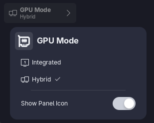

# GPU Supergfxctl Switch

A GNOME Shell Quick Settings extension for switching GPU profiles managed by [supergfxctl](https://gitlab.com/asus-linux/supergfxctl) on supported ASUS laptops.



## Compatibility

- GNOME Shell 46–51 (as declared in `metadata.json`)
- Published on [GNOME Extensions](https://extensions.gnome.org/extension/7018/gpu-supergfxctl-switch/)
- Tested on Arch with GNOME Shell 51.1 on Wayland; previously tested with GNOME 46 on X11 and Wayland
- Translations: Catalan, Arabic, and Japanese

The available profiles depend on the hardware and `supergfxctl` configuration:

- Integrated
- Hybrid
- Vfio
- AsusEgpu
- AsusMuxDgpu

The Quick Settings menu also includes a preference to show or hide the panel icon. Switching between Integrated and Hybrid logs out the current GNOME session. Direct switching between Vfio and Hybrid is not supported; switch to Integrated first.

## Requirements

- [supergfxctl](https://gitlab.com/asus-linux/supergfxctl)
- [asusctl](https://gitlab.com/asus-linux/asusctl)

Install and configure these dependencies for your distribution before enabling the extension.

## Installation

### GNOME Extensions

Install [GPU Supergfxctl Switch](https://extensions.gnome.org/extension/7018/gpu-supergfxctl-switch/) from GNOME Extensions.

 [](https://extensions.gnome.org/extension/7018/gpu-supergfxctl-switch/)

### Manual installation

Clone the repository and build the extension bundle, which packages the schema XML and compiled translations:

```bash
git clone https://github.com/chikobara/GPU-Switcher-Supergfxctl.git
cd GPU-Switcher-Supergfxctl
make pack
gnome-extensions install --force gpu-switcher-supergfxctl@chikobara.github.io.shell-extension.zip
```

Enable the extension after installation:

```bash
gnome-extensions enable gpu-switcher-supergfxctl@chikobara.github.io
```

To update a manual installation, pull the latest source, rebuild the bundle with `make pack`, and install the new bundle with `gnome-extensions install --force`.

## Contributing translations

Translation catalogs are in `po/`. To update them after changing user-facing strings, install GNU gettext, `jq`, and the GNOME Shell utilities, then run:

```bash
make update-po
```

Edit the relevant `po/<language>.po` file, then validate and package the translations:

```bash
make compile
make pack
```

The generated `.mo` catalogs and extension archive are build artifacts; the `.po` and `.pot` files are the sources to contribute.
